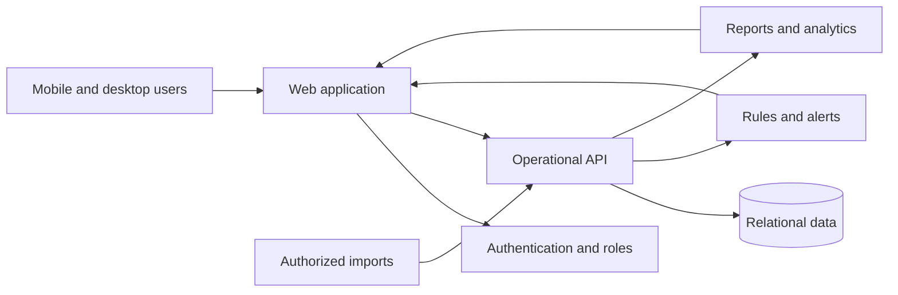

# Reference Architecture (Illustrative)

This diagram is a generic conceptual architecture, **not a production diagram or proprietary system specification**.

## Product decisions

- **Role-based access:** administrators, managers, dispatchers, supervisors and viewers need different permissions.
- **Event-oriented records:** preserve when operational events happened, who entered them, and what changed.
- **Transparent exceptions:** staff coverage, vehicle status, and dispatch delays should be explainable, not just shown as scores.
- **Human review:** AI can help discover patterns and propose actions, but leaders approve changes affecting employees or customer service.
- **Security:** keep secrets outside source control, minimize personal data, scope queries by tenant and location, and audit sensitive changes.

## Technology experience

Hands-on use of GitHub, JavaScript, SQL, Supabase and Cloudflare in developing web-based operations software. This portfolio intentionally does not expose private deployment architecture, credentials or organization-specific endpoints.
